  <a href="https://github.com/sshelfy/sshelfy">sshelfy</a> ·
  <a href="https://velosite.pl">velosite</a>

<picture>
  <source media="(prefers-color-scheme: dark)" srcset="https://raw.githubusercontent.com/St4rBoyeK/St4rBoyeK/output/snake-dark.svg">
  
</picture>
